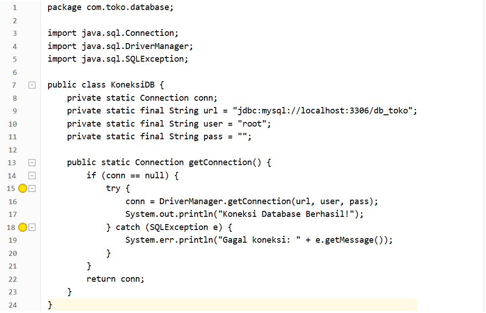
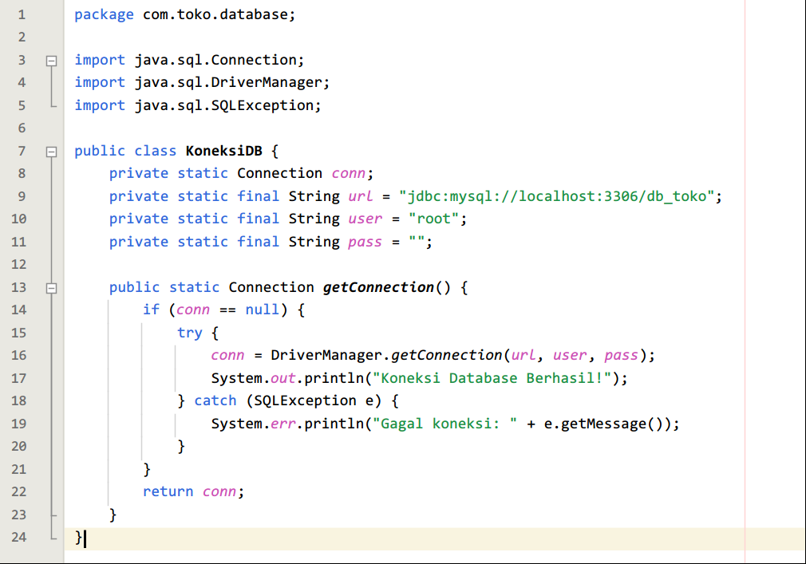
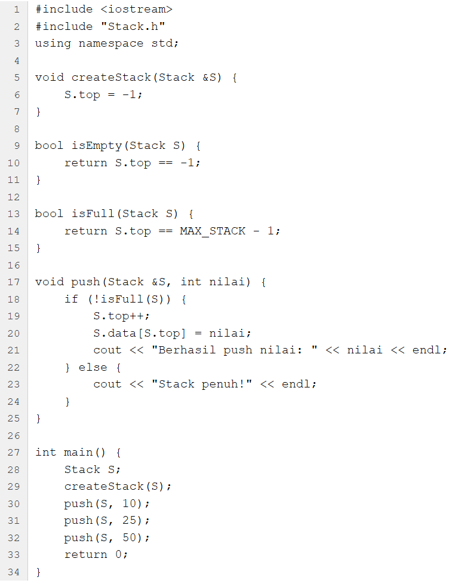
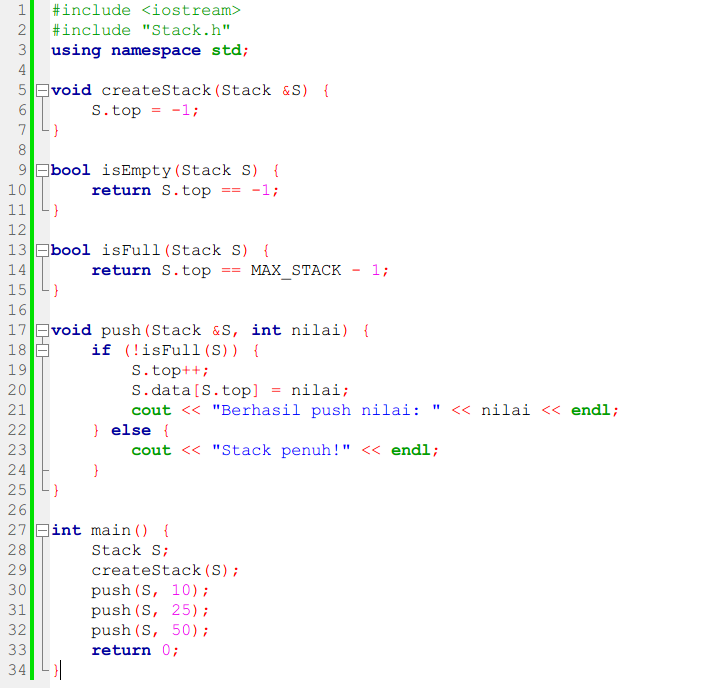
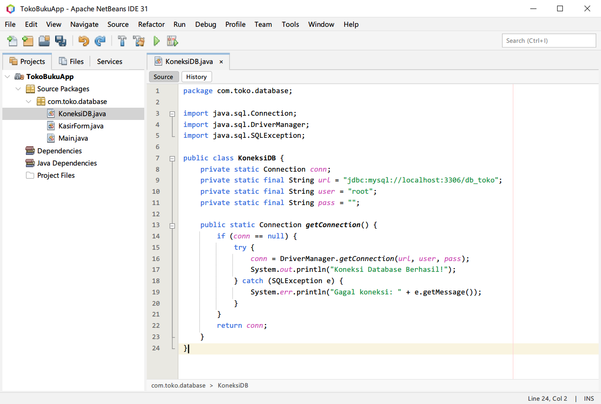
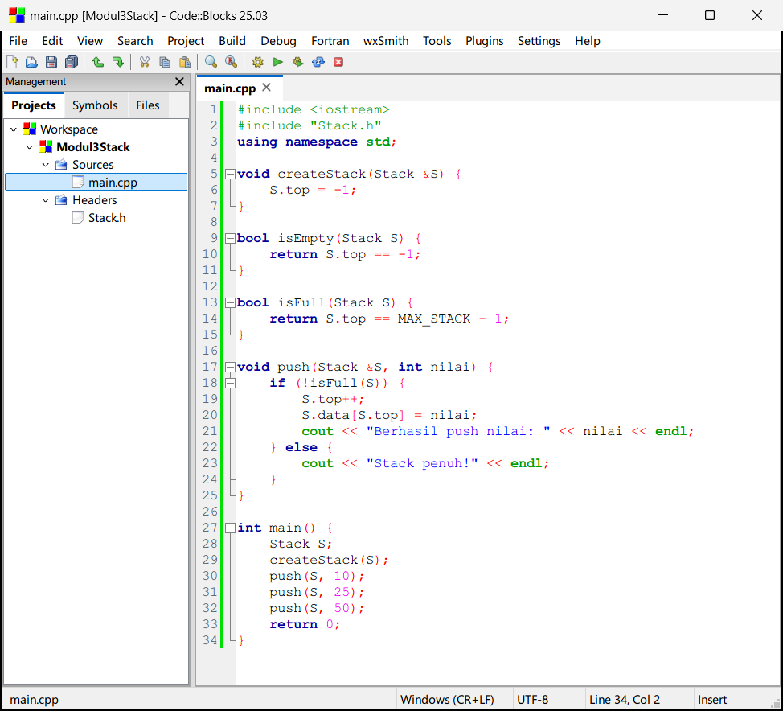
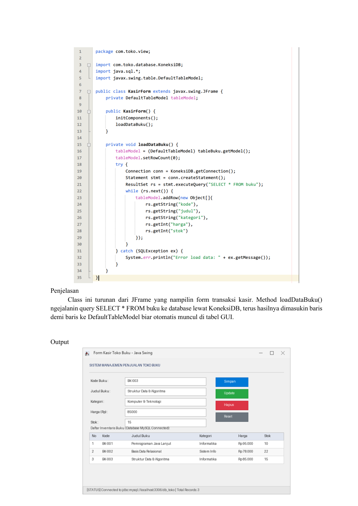
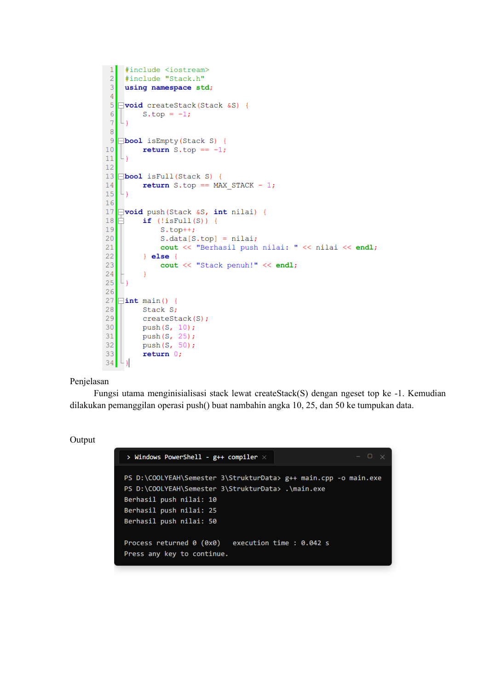

# NgeLaprak 🎓⚡
> **Universal AI Agent Skill & Generator Laporan Praktikum (Laprak)**  
> Otomatisasi penyusunan Laporan Praktikum lintas mata kuliah teknik/informatika ke dalam format **Microsoft Word (`.docx`)** dan **PDF (`.pdf`)** dengan tangkapan layar IDE otentik dan gaya penjelasan natural mahasiswa.

---

## 🚀 Mengapa NgeLaprak?

Seringkali saat menyuruh AI membuat laporan praktikum, hasilnya:
1. Terlihat **sangat kaku dan robotik** ("bahasa AI banget").
2. Tangkapan layar kode menggunakan kartu web palsu yang langsung ketahuan dosen/asisten.
3. Format dokumen berantakan, font tidak seragam, dan tata letak cover salah.

**NgeLaprak** dirancang khusus untuk memecahkan masalah ini. Dengan skill ini, AI Agent (seperti Google Antigravity, Claude Code, Cursor, Copilot) dapat membaca referensi modul dan template kampus Anda, lalu menghasilkan laprak siap kumpul yang **100% otentik**.

---

## ✨ Fitur Unggulan

### 1. 🌐 Universal untuk Semua Mata Kuliah
Dapat digunakan untuk berbagai mata kuliah pemrograman dan informatika:
* **ADPL & Pemrograman Berorientasi Objek (PBO)**: Java, Maven, Ant, Swing GUI, MySQL JDBC.
* **Struktur Data & Algoritma**: C++, Pointer, Struct, Linked List, Stack, Queue, Tree.
* **Basis Data**: SQL query, DDL/DML, Relasi tabel, ERD.
* **Pemrograman Web & Mobile**: JavaScript, HTML/CSS, React, Flutter, Python.
* **Sistem Operasi & Jaringan**: Bash terminal, packet tracing, Linux commands.

### 2. 📸 Engine Screenshot IDE Otentik (Mode Hybrid & Pixel-Perfect Native)
* **Apache NetBeans 31 (Java - FlatLaf Light)**:
  * Engine Java2D `LCD_HRGB` + JDK `javac` Compiler Tree API (pewarnaan semantik akurat untuk field, static call miring, Javadoc, dan badge `@Override`).
  * Tema **FlatLaf Light**: keyword biru (`#336BDD`), string hijau (`#1E9347`), field ungu-pink (`#CE54B8`), gutter (`#E9E8E2`), highlight baris aktif krem (`#F9F4E0`), dan margin guide pink (`#FFD4D4`).
  * Mendukung potongan editor (`--view editor`) maupun jendela Swing + FlatLaf lengkap (`--view full`) dengan ikon resmi JAR NetBeans.
* **Code::Blocks 25.03 (C/C++)**:
  * Engine native **wxScintilla + Win32 GDI** menggunakan `lexer_cpp.xml` resmi Code::Blocks (font Courier New 10pt, green changebar, marker fold Scintilla).
  * Mendukung `--view editor` maupun `--view full` (`wxWidgets` MenuBar, ToolBar ikon `resources.zip`/`compiler.zip`, Management tree, StatusBar).
* **VS Code & Windows Terminal**:
  * Dark+ / Light+ theme yang bersih dan konsol native Windows 11 / MySQL client.
* **Slot Screenshot Manual**:
  * Jika mahasiswa sudah mengambil screenshot sendiri dengan *Snipping Tool*, AI akan otomatis memprioritaskan screenshot asli tersebut.

#### 🔍 Perbandingan Hasil Render (`--view editor`): Sebelum vs Sesudah

Pengujian dilakukan pada cuplikan kode yang sama persis (`KoneksiDB.java` & `main.cpp` dari [examples/generate_samples.py](examples/generate_samples.py)):

##### 1) Apache NetBeans (`--ide netbeans --view editor`)

| Sebelum (`HTML / Chrome Mock`) | Sesudah (`Native Java2D + javac AST + FlatLaf Light`) |
| :---: | :---: |
|  |  |

- **Pewarnaan Semantik Nyata**: Versi lama berbasis regex/HTML gagal mewarnai keyword, string, dan field pada `KoneksiDB.java` (tercetak hitam polos); versi baru memakai **JDK `javac` Compiler Tree API** sehingga membedakan akurat keyword `#336BDD`, string `#1E9347`, static field *italic* `#CE54B8` (`conn`, `url`, `out`, `err`), serta pemanggilan static method *italic* (`getConnection`).
- **Gutter & Struktur Fold Otentik**: Gutter memakai warna FlatLaf Light `#E9E8E2`, garis konektor fold penuh (hanya pada `import`, `class`, `method`, dan Javadoc — bukan pada `if`/`try`), garis bantu indentasi `#D3D3D3`, pemandu margin kolom 80 `#FFD4D4`, dan subpixel font rasterization Java2D `LCD_HRGB`.

##### 2) Code::Blocks (`--ide codeblocks --view editor`)

| Sebelum (`HTML / Chrome Mock`) | Sesudah (`Native wxScintilla + lexer_cpp.xml`) |
| :---: | :---: |
|  |  |

- **Lexer & Rasterizer Asli**: Versi lama menggunakan DOM Chrome sehingga sintaks C++ gagal terwarnai konsisten dan tanpa *changebar*; versi baru merender langsung via komponen **native `wxScintilla` + Win32 GDI** dengan aturan `lexer_cpp.xml` resmi Code::Blocks (`#include` hijau, keyword `#0000A0` bold, `std`/`cout`/`endl` hijau bold, string biru `#0000FF`, literal `char` oranye `(224,160,0)`, green changebar `#00E000`, dan marker fold tree `[-]`).

##### 3) Pratinjau Mode Jendela IDE Penuh (`--view full`)

| Apache NetBeans 31 (`--view full`) | Code::Blocks 25.03 (`--view full`) |
| :---: | :---: |
|  |  |

| Aspek | Renderer Lama (HTML/Chrome) | Renderer Baru (Native Engine) |
| :--- | :--- | :--- |
| **Java / NetBeans** | Regex tokenizer + CSS di Headless Chrome | **Java2D `LCD_HRGB` + JDK `javac` AST** + Swing `FlatLightLaf` & ikon JAR resmi |
| **C++ / Code::Blocks** | Regex tokenizer + HTML di Headless Chrome | **wxScintilla + Win32 GDI** membaca `lexer_cpp.xml` & ikon `resources.zip` |
| **Viewport (`--view`)** | Hanya potongan editor (`editor`) | Mendukung **`--view editor`** dan **`--view full`** (jendela IDE utuh) |
| **Ketergantungan LLM** | 0 token (CLI deterministik) | 0 token (CLI deterministik, tanpa automasi GUI oleh LLM) |

### 3. ✍️ Gaya Penulisan Natural Mahasiswa (Anti-AI Cringe)
* Penjelasan singkat, padat, dan langsung menjelaskan fungsi teknis kode (*to the point*).
* Menghindari kalimat klise AI yang berlebihan.
* Menggunakan kosakata khas mahasiswa santai dan realistis.

### 4. 📄 Output Ganda (.docx & .pdf)
* Menghasilkan dokumen Word (`.docx`) dengan margin, font, dan cover yang identik dengan template kampus.
* Ekspor otomatis ke `.pdf` siap cetak/kumpul.

### 5. 🧠 Smart Context & Auto-Scaffold (Zero-Setup Workspace)
* **File Tercecer? Nggak Masalah!**: Cukup taruh berkas materi, TP, atau laprak lama di satu folder tanpa subfolder. `NgeLaprak` otomatis membuat struktur direktori (`Modul/`, `Laprak/`, `Code/`) dan memindahkan setiap berkas ke folder yang sesuai.
* **Deteksi Mandiri Tanpa Repot**: AI secara otomatis mengenali mata kuliah, modul target, identitas mahasiswa (Nama & NIM) dari riwayat laprak lama, bahasa kodingan, hingga IDE yang cocok.
* **Struktur Proyek Resmi IDE**: Otomatis menata proyek standar **Apache NetBeans (Maven)** (`pom.xml`, `nbactions.xml`, `src/main/java/{pkg}/`) untuk Java, dan **Code::Blocks** (`.cbp`) untuk C++, sehingga kodingan praktikum langsung dapat dibuka (*Open Project*) dan di-Run tanpa konfigurasi manual.

---

## 📂 Contoh Hasil Laporan Praktikum (Sample Outputs)

Repositori ini menyertakan contoh lengkap laporan praktikum yang dihasilkan oleh **NgeLaprak**:

| Mata Kuliah | Target IDE | Dokumen Word & PDF |
| :--- | :--- | :--- |
| **ADPL / PBO (Java)** | Apache NetBeans & Java Swing GUI | [`examples/adpl_modul4_sample/`](examples/adpl_modul4_sample/) <br> • [Download DOCX](examples/adpl_modul4_sample/LAPRAK_SAMPLE_ADPL_MODUL4.docx) <br> • [Download PDF](examples/adpl_modul4_sample/LAPRAK_SAMPLE_ADPL_MODUL4.pdf) |
| **Struktur Data (C++)** | Code::Blocks & Windows Console | [`examples/strukdat_modul3_sample/`](examples/strukdat_modul3_sample/) <br> • [Download DOCX](examples/strukdat_modul3_sample/LAPRAK_SAMPLE_STRUKDAT_MODUL3.docx) <br> • [Download PDF](examples/strukdat_modul3_sample/LAPRAK_SAMPLE_STRUKDAT_MODUL3.pdf) |

### 🖼️ Cuplikan Halaman Laporan

| ADPL / PBO (Java NetBeans & GUI) | Struktur Data (C++ Code::Blocks) |
| :---: | :---: |
|  |  |

---

## 📥 Cara Instalasi (Sangat Mudah)

### ⭐ Opsi 1: Lewat `npx skills` (Paling Praktis untuk AI Coding Agent)
Bagi pengguna **Antigravity, Cursor, Claude Code, Cline, Codex, Amp**, cukup jalankan satu perintah:

```bash
# Pasang ke proyek saat ini
npx skills add SatriaBaktiWijaya/NgeLaprak

# ATAU pasang secara global ke semua proyek
npx skills add SatriaBaktiWijaya/NgeLaprak -g
```
*Skills CLI akan otomatis mendeteksi AI Agent yang terpasang dan mengkonfigurasi skill tanpa perlu copy manual.*

---

### 📦 Opsi 2: Lewat `npx ngelaprak`
Bisa langsung dijalankan dari terminal:
```bash
npx ngelaprak install
```

---

### 🖥️ Opsi 3: Windows (PowerShell) - 1 Klik
Cukup clone dan jalankan skrip installer:
```powershell
git clone https://github.com/SatriaBaktiWijaya/NgeLaprak.git
cd NgeLaprak
.\install.ps1
```
Skrip ini akan otomatis memasang dependensi Python (`python-docx`, `pillow`, `pypdf`, `pdfplumber`, `wxPython`) dan mendaftarkan skill ke direktori agen global (`~/.gemini/config/skills/ngelaprak`).

> **Catatan Prasyarat Renderer Native (Windows):**
> - **NetBeans Renderer**: Membutuhkan **JDK 17+** (`javac` & `java` di `PATH`) dan opsional instalasi **Apache NetBeans** (untuk `flatlaf-*.jar`, `jsvg-*.jar`, dan ikon SVG/PNG resmi).
> - **Code::Blocks Renderer**: Membutuhkan **`wxPython`** (`pip install wxPython`) dan opsional instalasi **Code::Blocks** (`lexer_cpp.xml` & ikon `resources.zip`; memiliki fallback style built-in bila tidak terpasang).

---

### 🐧 Opsi 4: Linux / macOS
```bash
git clone https://github.com/SatriaBaktiWijaya/NgeLaprak.git
cd NgeLaprak
chmod +x install.sh
./install.sh
```

---

## 💡 Cara Penggunaan dengan AI Agent

Setelah skill terpasang, kamu cukup membuka AI Agent favoritmu di folder mata kuliah dan memberikan instruksi seperti biasa:

```text
"Tolong kerjain laprak modul 4. Modul ada di folder Modul, contoh/template 
ada di folder Laprak, dan projek kodingannya ada di folder Code. Tolong buatkan 
sampai jadi Word (.docx) dan PDF-nya."
```

AI Agent akan otomatis:
1. Membaca materi dan tugas di modul.
2. Membaca format cover, nama, NIM, asisten, dan font dari template/laprak lama.
3. Menjalankan dan memverifikasi kodingan projek.
4. Menghasilkan screenshot IDE (NetBeans/CodeBlocks/VS Code) atau mengambil file yang kamu sediakan.
5. Menyusun penjelasan ringkas berbahasa mahasiswa.
6. Menyimpan dokumen `.docx` dan `.pdf` yang rapi dan terstruktur.

---

## 🛠️ CLI Mandiri (Opsional)

Jika ingin menggunakan tool mandiri lewat terminal:
```bash
# Auto-scaffold dan rapikan file tercecer ke Modul/, Laprak/, dan Code/
python -m ngelaprak organize

# Deteksi otomatis konteks modul, mahasiswa, bahasa & IDE
python -m ngelaprak analyze

# Inisialisasi struktur folder laporan (bisa langsung spesifik IDE: --lang java / --lang cpp)
python -m ngelaprak init --lang java
python -m ngelaprak init --lang cpp

# Render screenshot kode IDE (editor saja atau full window)
python -m ngelaprak render --ide netbeans --view editor --file ./src/Main.java --out ./shot.png
python -m ngelaprak render --ide netbeans --view full --project KasirApp --file ./src/Main.java --out ./shot_full.png
python -m ngelaprak render --ide codeblocks --view full --project Modul3Stack --file ./main.cpp --out ./cb_full.png

# Ekspor Word ke PDF
python -m ngelaprak export-pdf --docx ./Laprak.docx
```

---

## 📂 Struktur Repositori

```
NgeLaprak/
├── SKILL.md              # Spesifikasi lengkap instruksi AI Agent
├── install.ps1           # Skrip instalasi Windows
├── install.sh            # Skrip instalasi Linux/macOS
├── package.json          # Runner npm / npx
├── docs/images/          # Aset gambar perbandingan Before vs After (--view editor & --view full)
├── ngelaprak/            # Paket Python Core
│   ├── cli.py            # Terminal interface (--view editor|full)
│   ├── core/             # Analyzer, docx builder, pdf exporter
│   └── renderers/        # Native NetBeans (Java2D/Swing), Code::Blocks (wxScintilla), VS Code, GUI Framer
└── templates/            # Aset tema, ikon Java, dan layout cover
```

---

## 👤 Pembuat
Dibuat oleh **Satria Bakti Wijaya**  
Telkom University Purwokerto  
GitHub: [https://github.com/SatriaBaktiWijaya/NgeLaprak](https://github.com/SatriaBaktiWijaya/NgeLaprak)
