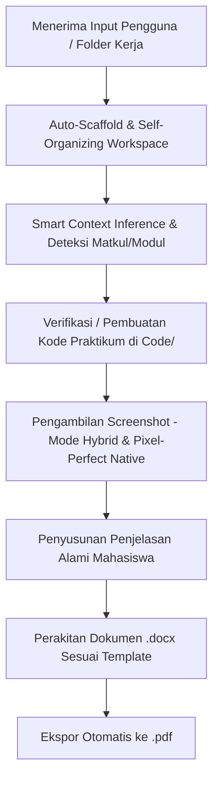

# NgeLaprak: Universal Laboratory Report Generator Skill

Skill ini memandu AI Agent dalam menyusun **Laporan Praktikum (Laprak)** yang rapi, profesional, dan otentik untuk berbagai mata kuliah teknik/informatika (seperti Struktur Data, ADPL, PBO, Basis Data, Pemrograman Web, Sistem Operasi, Jaringan Komputer, dll.).

Skill ini dilengkapi dengan kemampuan:
- **Auto-Scaffold & Self-Organizing Workspace**: Merapikan file tercecer menjadi struktur folder standar praktikum.
- **Smart Context Auto-Detection**: Mendeteksi mata kuliah, modul, data mahasiswa, bahasa, dan IDE tanpa banyak tanya.
- **Native Pixel-Perfect IDE Renderers (PR #6)**: Menghasilkan tangkapan layar IDE otentik tanpa mock HTML/browser, mendukung mode potongan editor (`--view editor`) maupun jendela penuh desktop IDE (`--view full`) untuk Apache NetBeans (Java2D AST) dan Code::Blocks (wxScintilla Win32 GDI).
- **Anti-Plagiarism Protection**: Penyisipan nama/NIM di kode, jitter dimensi gambar acak (~15–55 px), dan simulasi CLI interaktif.
- **Standarisasi Tipografi Anti-Bold**: Proteksi otomatis agar teks laporan tidak mewarisi format bold dari heading template.
- **Ekspor Otomatis**: Menghasilkan berkas **Microsoft Word (`.docx`)** dan **PDF (`.pdf`)** siap kumpul.

---

## 1. Alur Kerja Utama (Workflow)



### Langkah 0: Smart Auto-Scaffold & Self-Organizing Workspace (Zero-Setup)
Banyak mahasiswa mengunduh berkas modul, template, dan TP lalu menaruh semuanya sekaligus di satu folder tanpa membuat subfolder (misal: di folder hanya ada `Modul 3.pdf`, `TP MODUL 3 STD.pdf`, dan `STRUKTUR-DATA_MOD-2_...pdf`).

Ketika dipanggil, AI Agent harus **segera merapikan direktori kerja secara mandiri**:
1. **Deteksi Berkas Tercecer (Loose Files)**:
   Periksa root direktori kerja. Jika berkas tercecer tanpa subfolder standar:
2. **Otomatis Buat Struktur Folder & Pindahkan Berkas**:
   - `Modul/` -> Berkas modul praktikum (`Modul*.pdf`, panduan, jobsheet) dan Tugas Pendahuluan (`TP*.pdf`, `Tugas Pendahuluan*`).
   - `Laprak/` -> Berkas laporan praktikum terdahulu / contoh template (`*_MOD-*`, `laprak*`, `template*`).
   - `Laprak/screenshots/` -> Tempat tangkapan layar manual atau hasil render.
   - `Code/` -> Folder projek / kodingan praktikum (`*.cpp`, `*.java`, `*.py`, `*.sql`, dll.).
   *(AI Agent dapat langsung menjalankan `python -m ngelaprak organize --path .` atau memindahkan berkas secara aman).*

---

### Langkah 0.5: Smart Context Auto-Detection (Deteksi Mandiri Tanpa Banyak Tanya)
AI Agent menganalisis berkas-berkas yang ada secara mandiri tanpa merepotkan pengguna dengan pertanyaan redundan:
1. **Deteksi Mata Kuliah**:
   - Ditelusuri dari nama berkas (misal `STRUKTUR-DATA_...` -> Struktur Data, `ADPL...` -> ADPL, `BASIS-DATA...` -> Basis Data).
   - Ditelusuri dari isi dokumen (header modul, judul matkul).
2. **Deteksi Modul Target**:
   - Ditelusuri dari nama berkas modul/TP (misal: ada `Modul 3.pdf` dan `TP MODUL 3 STD.pdf`, maka target yang dikerjakan adalah **Modul 3**).
   - Jika terdapat berkas `...MOD-2...`, sistem secara cerdas memahami bahwa Modul 2 adalah berkas referensi/template terdahulu!
3. **Deteksi Identitas Mahasiswa**:
   - NIM diekstrak dari penamaan berkas laprak lama (misal `109092500017`) atau teks cover.
   - Nama mahasiswa diekstrak dari penamaan berkas atau teks cover laprak lama (misal `Satria Bakti Wijaya`).
   - Asisten Praktikum diekstrak dari cover dokumen referensi.
4. **Deteksi Bahasa Pemrograman & Pilihan IDE**:
   - Jika ada kodingan di `Code/`, periksa ekstensi file (`.cpp` -> C++/Code::Blocks, `.java` -> Java/NetBeans, `.sql` -> SQL/DBeaver, `.py` -> Python/VS Code).
   - Jika folder `Code/` masih kosong, periksa kata kunci di modul materi (misal: `#include <iostream>`, `struct`, `cin` -> C++/Code::Blocks).
5. **Deteksi Institusi, Kampus & Identitas (Agnostik Multi-Kampus)**:
   - **Institusi**: Mendeteksi nama universitas, institut, politeknik, sekolah tinggi, atau akademi mana pun (Telkom, UI, ITB, UGM, ITS, Undip, Brawijaya, Polban, PENS, dll.).
   - **Identitas**: Fleksibel mendeteksi format nomor induk mahasiswa (`NIM`, `NPM`, `NRP`, `NISN`) baik dalam paragraf bertab maupun di dalam tabel identitas cover.
   - **Fakultas & Prodi**: Mengekstrak nama fakultas/sekolah dan program studi/jurusan/departemen langsung dari dokumen referensi tanpa memaksakan nilai default.
   - **Preservasi & Ekstraksi Logo**:
     - Jika template berformat `.docx`: Seluruh logo dan gambar cover otomatis dipertahankan pada posisi aslinya.
     - Jika template berformat `.pdf`: Gambar/logo cover diekstrak otomatis via `extract_cover_images_from_pdf` dan disematkan kembali ke cover baru.
6. **Deteksi Ketersediaan Kode**:
   - Jika kodingan belum tersedia di `Code/`, Agent secara mandiri memahami bahwa kodingan perlu dibuatkan di folder `Code/`, diuji coba jalannya, lalu diambil tangkapan layar outputnya.
7. **Saran Nama File Output Otomatis**:
   - Menyesuaikan format kampus dari template lama, misal `STRUKTUR-DATA_MOD-2_...` diubah otomatis menjadi `STRUKTUR-DATA_MOD-3_109092500017_SatriaBaktiWijaya.docx` (dan `.pdf`).

**Komunikasi Proaktif & Ringkas kepada Pengguna:**
Sampaikan temuan dalam 1–2 kalimat santai:
> *"Folder kerja sudah kurapikan ke `Modul/`, `Laprak/`, dan `Code/`. Aku mendeteksi tugas **Struktur Data - Modul 3 (ADT)** atas nama **Satria Bakti Wijaya (109092500017)** dengan **C++/Code::Blocks**. Karena kodingan praktikum belum ada, aku akan buatkan kodingannya di `Code/`, uji kompilasi & run, ambil screenshot, lalu rangkai laporannya. Boleh langsung kulanjutkan?"*

---

### Langkah 1: Ekstraksi Masukan & Anti-Plagiarisme
1. **Modul Praktikum (`Modul/Modul*.pdf`)**:
   - Ekstrak: Judul Pertemuan/Modul, Tujuan Praktikum, Tool yang digunakan, Dasar Teori, dan daftar tugas (Guided, Unguided, Latihan, Tugas Praktikum).
2. **Template Laprak Lama (`Laprak/*.docx` / `*.pdf`)**:
   - Ekstrak "DNA" laporan:
     - **Cover**: Format judul, logo kampus (posisi tengah/kiri, 1 atau 2 logo), format nama mahasiswa, NIM/NPM/NRP, asisten praktikum, prodi/jurusan, fakultas, institusi, dan tahun.
     - **Tipografi & Spasi**: Font (Times New Roman / Arial / Calibri), margin (4-4-3-3 atau 1 inci), spasi 1.15.
     - **Sistem Penomoran**: Romawi (I. TUJUAN, II. TOOL, III. DASAR TEORI, IV. GUIDED) atau huruf/angka.
3. **Kode Program (`Code/`)**:
   - Sisipkan identitas mahasiswa (Nama/NIM) di komentar `@author` kodingan atau title bar window untuk mencegah plagiarisme.
4. **Tugas Pendahuluan (TP) (Jika Ada)**:
   - Jawab pertanyaan TP secara singkat, padat, dan akurat dengan variasi kalimat natural mahasiswa.

---

### Langkah 2: Standarisasi Struktur Proyek IDE & Eksekusi Kode
Ketika mengimplementasikan atau menata kode praktikum mahasiswa di folder `Code/`, AI Agent **WAJIB** menerapkan struktur proyek resmi sesuai IDE target agar mahasiswa dapat langsung membukanya di Apache NetBeans atau Code::Blocks tanpa error:

1. **Untuk Java (Target IDE: Apache NetBeans)**:
   - **WAJIB** menggunakan struktur standar **Maven Project**:
     ```
     Code/
     ├── pom.xml                                  <- Konfigurasi Maven (Release 21/25 + dependencies)
     ├── nbactions.xml                            <- Pemetaan shortcut Run F6 NetBeans ke Main class
     └── src/
         └── main/
             └── java/
                 └── {packageName}/               <- Package sesuai deklarasi 'package ...;'
                     ├── *.java
     ```
   - **Auto-Dependency**: Jika kode menggunakan database (JDBC, MySQL, DriverManager, ResultSet), **WAJIB** sertakan dependensi `mysql-connector-j:8.3.0` di `pom.xml`.
   - **Main Class**: Pastikan `<exec.mainClass>` di `pom.xml` dan `nbactions.xml` menunjuk tepat ke kelas utama (misal `modul4.Main`).
   - *Dengan struktur ini, saat mahasiswa membuka NetBeans via `File -> Open Project` ke folder `Code`, NetBeans langsung memunculkan ikon cangkir kopi proyek resmi, tidak ada peringatan "Incorrect Package", dan tombol Run (F6) langsung berjalan lancar.*

2. **Untuk C / C++ (Target IDE: Code::Blocks)**:
   - **WAJIB** menyertakan berkas proyek Code::Blocks (`.cbp`):
     ```
     Code/
     ├── {ProjectName}.cbp                        <- File project Code::Blocks
     ├── main.cpp
     ├── {header}.h
     └── {source}.cpp
     ```
   - **Penanganan Multi-Task (Banyak Fungsi `main()`)**:
     - Jika modul praktikum memiliki beberapa soal terpisah yang masing-masing memiliki fungsi `main()` (misal `soal1.cpp`, `soal2.cpp`, `soal3.cpp`), **JANGAN** satukan dalam 1 file `.cbp` root (karena GCC akan memicu linker error `multiple definition of 'main'`).
     - **Pisahkan ke subfolder per tugas** (misal `Code/soal1/soal1.cbp`, `Code/soal2/soal2.cbp`) sehingga setiap project `.cbp` memiliki tepat 1 fungsi `main()`.
   - *Dengan struktur ini, mahasiswa cukup mendua-klik file `.cbp` untuk membuka project tree (Sources & Headers) di Code::Blocks dan langsung mengompilasi/menjalankan via shortcut F9.*

3. **Kompilasi & Validasi Kode**:
   - Kompilasi dan jalankan kode menggunakan tool yang sesuai (`mvn compile`, `g++`, `python`, `node`, dll.).
   - Pastikan tidak ada compile error.
   - Tangkap output program (console stdout, GUI window, database grid).

---

### Langkah 3: Screenshot Kode & Output (Mode Hybrid & Pixel-Perfect Native)

Gunakan **Mode Hybrid** untuk mendapatkan tangkapan layar yang paling otentik:

1. **Prioritas 1 - Screenshot Manual Mahasiswa**:
   - Periksa apakah mahasiswa telah menaruh screenshot asli di `Laprak/screenshots/`. Jika ada, gunakan file tersebut.

2. **Prioritas 2 - Generator Otomatis IDE Otentik (`ngelaprak.renderers`)**:
   - Jika screenshot manual tidak tersedia, gunakan generator bawaan `ngelaprak` dengan engine native IDE resmi:
     - **Java / Apache NetBeans (`netbeans_renderer.py` + `NetBeansNativeRenderer.java`)**:
       - Engine Java2D `LCD_HRGB` subpixel font rasterization + `javac` Compiler Tree API (`com.sun.source.tree.*`, `com.sun.source.util.*`).
       - Resolusi semantik nyata: pembedaan field statik vs instance (magenta `#CE54B8`, statik miring), pemanggilan method statik (*italic*), Javadoc tags & HTML tags, kotak fold code (`[-]`/`[+]`), dan badge `@Override` lingkaran hijau berinti putih pada gutter.
       - Skema warna resmi **Apache NetBeans 31 FlatLaf Light**:
         - Background: `#FFFFFF`
         - Keyword: `#336BDD`
         - String literal: `#1E9347`
         - Static & Member field: `#CE54B8`
         - Comment: `#969696` (*italic*)
         - Gutter background: `#E9E8E2`, Gutter border: `#D6D5CE`
         - Baris aktif (active line): `#F9F4E0` (krem pastel)
         - Right margin guide: `#FFD4D4` pada kolom 80
       - Mode Tampilan:
         - `--view editor`: Irisan kode editor + gutter + fold lines + margin guide pink.
         - `--view full`: Jendela Swing desktop lengkap dengan FlatLightLaf, title bar, menu bar, toolbar dengan ikon asli JAR NetBeans, panel Projects tree (menampilkan package & sibling files), tab bar editor, output pane, dan status bar memory monitor.
     - **C / C++ / Code::Blocks (`codeblocks_renderer.py`)**:
       - Engine native **`wxWidgets` `wx.stc.StyledTextCtrl` (wxScintilla)** yang di-capture via Win32 GDI `PrintWindow` API (`ctypes.windll.user32.PrintWindow`, `GetDIBits`).
       - Parser lexer resmi `lexer_cpp.xml` dari Code::Blocks:
         - Font: Courier New 10pt
         - Keywords: Dark blue bold `#0000A0`
         - Preprocessor (`#include`): Green `#00A000`
         - STL & Streams (`std`, `cout`, `cin`, `endl`): Green bold `#00A000`
         - Strings: Blue `#0000FF`
         - Character literals: Orange `RGB(224, 160, 0)`
         - Changebar: Bar vertikal hijau `#00E000` di margin gutter
         - Fold markers: Scintilla boxed tree lines (`[-]`/`[+]`)
       - Mode Tampilan:
         - `--view editor`: Area editor Scintilla + gutter + fold margin + changebar hijau.
         - `--view full`: Jendela `wx.Frame` + `wx.aui.AuiManager` lengkap dengan menu bar, toolbar Main & Compiler (ikon resmi `resources.zip`/`compiler.zip`), panel Management (Workspace -> Project -> Sources & Headers), editor tab bar, panel Logs & others, dan 6-segment status bar.
     - **Python / Web / VS Code (`vscode_renderer.py`)**:
       - **DEFAULT: Tema Gelap (Dark+ / Dark Modern)** dengan editor background `#1e1e1e`, tab bar aktif dengan ikon bahasa dan tombol close, breadcrumb navigasi, gutter abu-abu `#858585`, serta syntax highlighting otentik (keywords biru `#569cd6`, control flow magenta `#c586c0`, string oranye `#ce9178`, angka `#b5cea8`, fungsi `#dcdcaa`, komentar `#6a9955`).
       - Selalu gunakan `theme="dark"` sebagai standar default saat men-generate tangkapan layar untuk tugas berbasis Python, JavaScript, TypeScript, Web, atau ketika target IDE yang diminta adalah Visual Studio Code.
     - **Basis Data / SQL (`database_renderer.py`)**:
       - Tampilan editor query DBeaver / Navicat lengkap dengan syntax highlight dan tabel data grid baris & kolom hasil eksekusi.
     - **Terminal / Console & Simulasi CLI Interaktif (`terminal_renderer.py` & `cli_simulator.py`)**:
       - Console Command Prompt Windows / PowerShell / Bash terminal otentik.
       - **Simulasi Input Interaktif Mahasiswa**: Menampilkan alur interaksi multi-step (misal operasi CRUD, Stack push/pop, Queue antrian, Traversal Tree, Sorting pass-by-pass) dengan penanda visual input keyboard mahasiswa (`[[INPUT]]`), judul menu (`[[HEADER]]`), dan hasil sukses (`[[SUCCESS]]`). Menghindarkan kesan program yang hanya di-run 1 detik tanpa interaksi.
     - **Ekstraksi Logo Cover PDF Otomatis (`extract_cover_logo_from_pdf`)**:
       - Jika pengguna hanya menyertakan berkas laporan lama atau panduan berformat `.pdf` tanpa file Word `.docx`, sistem secara mandiri mengekstrak logo cover resolusi terbaik dari halaman 1 PDF dan menyimpannya ke `Laprak/screenshots/cover_logo.png` untuk disematkan ke cover Word baru.
     - **Jendela Java Swing Native (`gui_framer.py`)**:
       - Frame Windows 11 native dengan ikon cangkir Java 3D dan tombol vector native (Minimize, Maximize, Close X).
     - **Anti-Plagiarisme Dimensi Gambar**:
       - Seluruh renderer otomatis menyisipkan jitter acak (~15–55 px) sehingga ukuran pixel gambar setiap mahasiswa unik dan berbeda.

---

### Langkah 4: Gaya Bahasa Penulisan (Human-Like & Anti-AI)

Tuliskan penjelasan kode dan dasar teori dengan aturan berikut:
- **Gaya Bahasa Mahasiswa Santai & Pragmatis**: Singkat, jelas, langsung ke fungsi kode (*to the point*).
- **Hindari Ciri Bahasa AI**:
  - JANGAN gunakan kata-kata klise robotik: *"Kode ini mendemonstrasikan implementasi komprehensif...", "Melalui arsitektur ini, integritas data terjamin..."*.
  - GUNAKAN gaya natural mahasiswa: *"Fungsi ini dipake buat...", "Di sini kita inisialisasi struct kendaraan...", "Bagian ini buat nampilin data yang udah diinput..."*.

---

### Langkah 5: Standarisasi Tipografi Dokumen Sesuai Template (Anti-Bold Liar)

Untuk memastikan dokumen Word & PDF **100% identik dengan format acuan kampus/asisten** dan tidak terjadi kesalahan teks tebal (*bold*) yang berlebihan:

#### 1. Tabel Standarisasi Elemen & Font Dokumen:

| Bagian Dokumen | Elemen Teks | Jenis Font | Ukuran Font | Status Bold | Alignment | Indentasi / Catatan |
|---|---|---|---|---|---|---|
| **Cover** | Judul Modul & Pertemuan | Times New Roman | 14 pt | **Bold (`True`)** | Center | Line spacing 1.15 |
| **Cover** | Nama Mahasiswa | Times New Roman | 12 pt | **Bold (`True`)** | Left / Tab | Label & Nama Mahasiswa |
| **Cover** | Nama (NIM) | Times New Roman | 12 pt | **Non-Bold (`False`)** | Left / Tab | Angka NIM tidak di-bold |
| **Cover** | Asisten Praktikum | Times New Roman | 12 pt | **Non-Bold (`False`)** | Left / Tab | Nama & NIM asisten tidak bold |
| **Bab Utama** | `I. TUJUAN`, `II. TOOL`, `III. DASAR TEORI`, `IV. GUIDED` | Times New Roman | 14 pt | **Bold (`True`)** | Justify | Spasi Before 10pt, After 4pt |
| **I. TUJUAN** | Butir Poin (`1. ...`, `2. ...`) | Times New Roman | 12 pt | **Non-Bold (`False`)** | Justify | Spasi After 2pt |
| **II. TOOL** | Deskripsi Tool (`NetBeans, JDK 25...`) | Times New Roman | 11 pt | **Non-Bold (`False`)** | Left | Left Indent 0.4 inci |
| **III. DASAR TEORI**| Paragraf Penjelasan Teori | Times New Roman | 12 pt | **Non-Bold (`False`)** | **Justify** | **First-line indent ~0.35–0.4 in (~0.8 cm)**, spasi 1.15 |
| **IV. GUIDED** | Sub-item Kode (`1.) TestJDBC.java`) | Times New Roman | 11 pt | **Non-Bold (`False`)** | Justify | Spasi Before 8pt, After 2pt |
| **IV. GUIDED** | Label `Kode` | Times New Roman | 11 pt | **Non-Bold (`False`)** | Justify | Spasi Before 4pt, After 2pt |
| **IV. GUIDED** | Gambar Screenshot Kode (`--view editor`) | - | - | - | Center | Lebar 5.2–5.5 inci, Spasi After 6pt |
| **IV. GUIDED** | Gambar Full Window IDE (`--view full`) | - | - | - | Center | Lebar 5.8–6.0 inci, Spasi After 6pt |
| **IV. GUIDED** | Label `Penjelasan` | Times New Roman | 11 pt | **Non-Bold (`False`)** | Justify | Spasi Before 4pt, After 2pt |
| **IV. GUIDED** | Paragraf Penjelasan Kode | Times New Roman | 11 pt | **Non-Bold (`False`)** | **Justify** | **First-line indent ~0.4 in (~1 cm)**, spasi 1.15 |
| **Output** | Label `Output` | Times New Roman | 11 pt | **Non-Bold (`False`)** | Justify | Spasi Before 8pt, After 2pt |
| **Output** | Gambar Screenshot GUI / DB / CLI | - | - | - | Center | Lebar 4.8–5.2 inci, Spasi After 6pt |

#### 2. Aturan Larangan Teknis Agent (Critical Rule):
- **DILARANG KERAS** menggunakan `doc.paragraphs[x].text = "..."` secara mentah pada paragraf bawaan template!
  - *Penyebab*: Jika paragraf tersebut memiliki style Heading (misal `Heading 1`), python-docx akan menghapus run sebelumnya dan membuat run baru tanpa tag `<w:b w:val="0"/>`, sehingga teks mewarisi sifat bold dari Heading. Inilah yang menyebabkan Tujuan dan Dasar Teori menjadi **bold semua**.
- **WAJIB** gunakan metode terstruktur `LaprakDocxBuilder` yang telah terintegrasi dengan proteksi tipografi otomatis (`sanitize_document_typography()`).

---

### Langkah 6: Panduan Pemilihan View Mode & Ukuran Gambar di Word (`.docx`)

| Aspek | `--view editor` (Snippet Irisan Kode) | `--view full` (Jendela Lengkap Desktop IDE) |
|---|---|---|
| **Kegunaan Utama di Laprak** | Pembahasan langkah-langkah tugas Guided & Unguided; penjelasan baris per baris method, query, struct, atau fungsi. | Verifikasi struktur proyek, menampilkan hirarki paket Maven di NetBeans Projects panel, struktur workspace `.cbp` di Code::Blocks, atau tampilan keseluruhan lingkungan IDE. |
| **Rekomendasi Lebar di Word** | `5.2` sampai `5.5` inci (`Inches(5.2)` – `Inches(5.5)`) | `5.8` sampai `6.0` inci (`Inches(5.8)` – `Inches(6.0)`) |
| **Rasio Aspek & Dimensi** | Strip vertikal kompak (~400–700 px tinggi tergantung baris). | Lanskap widescreen (~16:10 atau 16:9, min 980x560 px). |
| **Manajemen Halaman** | Sangat ideal diletakkan bersamaan dengan 2–3 paragraf penjelasan mahasiswa pada satu halaman. | Memakan ~0.4–0.5 halaman A4; letakkan di bagian awal bab atau sub-bab verifikasi proyek agar tidak memotong halaman secara canggung. |

---

## 2. Matriks Parameter Renderer & CLI Reference

### 2.1 Perintah CLI: `python -m ngelaprak render`

| Parameter | Tipe | Nilai yang Diizinkan | Default | Fungsi & Perilaku |
|---|---|---|---|---|
| `--ide` | string | `netbeans`, `codeblocks`, `vscode`, `database` | `netbeans` | Menentukan engine renderer IDE target. |
| `--view` | string | `editor`, `full` | `editor` | `editor`: Irisan kode editor + gutter + fold lines + margin guide.<br>`full`: Jendela GUI desktop IDE lengkap (FlatLaf Swing untuk NetBeans, wxAui untuk Code::Blocks). |
| `--file` | path | Path berkas sumber yang valid | **Wajib** | Berkas kode sumber yang akan dirender (`.java`, `.cpp`, `.c`, `.h`, `.py`, dll.). |
| `--out` | path | Filepath PNG (`.png`) | `screenshot.png` | Tujuan penyimpanan gambar output. Direktori parent dibuat otomatis jika belum ada. |
| `--project` | string | String identifier | `ProjekPraktikum` | Nama projek pada title bar jendela IDE dan root panel Projects / Management di `--view full`. |
| `--filename` | string | String nama file | `None` (auto) | Menimpa judul tab editor dan nama node di pohon berkas (default mengambil `os.path.basename(--file)`). |
| `--theme` | string | `dark`, `light` | `dark` | Tema warna editor (terutama untuk VS Code; NetBeans selalu FlatLaf Light resmi, Code::Blocks selalu Scintilla Light). |
| `--start` | int | Integer $\ge 1$ | `1` | Nomor baris awal irisan kode yang ditampilkan pada editor. |
| `--end` | int | Integer $\ge \text{start}$ | `None` (EOF) | Nomor baris akhir irisan kode yang ditampilkan pada editor. |

---

### 2.2 Programmatic Python API

#### 1. `render_netbeans_code` (`ngelaprak.renderers.netbeans_renderer`)
```python
def render_netbeans_code(
    filename: str,                         # e.g., "KoneksiDB.java"
    code_text: str,                        # Source code Java lengkap / potongan
    start_line: int = 1,                   # Baris awal (1-based)
    end_line: int | None = None,           # Baris akhir (1-based, None = seluruh berkas)
    out_path: str = "netbeans_shot.png",   # Path berkas output .png
    active_line_offset: int | None = None, # Baris yang disorot krem aktif (#F9F4E0)
    with_margin_guide: bool = True,        # Render margin guide pink kolom 80 (#FFD4D4)
    with_cursor: bool = True,              # Render blinking cursor line '|'
    author_tag: str | None = None,         # Inject // @author <name> jika belum ada
    view: str = "editor",                  # "editor" atau "full"
    project_name: str = "ProjekPraktikum", # Nama project di title bar & panel Projects
    extra_files: list[str] | None = None,  # Daftar sibling files di panel package tree
    sourcepath: str | None = None,         # Path root src/main/java untuk javac AST
) -> str
```

#### 2. `render_codeblocks_code` (`ngelaprak.renderers.codeblocks_renderer`)
```python
def render_codeblocks_code(
    code_text: str,                        # Source code C / C++
    start_line: int = 1,                   # Baris awal (1-based)
    end_line: int | None = None,           # Baris akhir (1-based, None = seluruh berkas)
    out_path: str = "codeblocks_shot.png", # Path berkas output .png
    with_cursor: bool = True,              # Render blinking cursor
    author_tag: str | None = None,         # Inject // @author <name> jika belum ada
    view: str = "editor",                  # "editor" atau "full"
    filename: str = "main.cpp",            # Nama tab aktif & node tree
    project_name: str = "ProjekPraktikum", # Nama project di title bar & Workspace tree
    extra_files: list[str] | None = None,  # Sibling files (Sources & Headers)
) -> str
```

#### 3. `render_vscode_code` (`ngelaprak.renderers.vscode_renderer`)
```python
def render_vscode_code(
    code_text: str,                        # Source code (Python, JS, TS, HTML, dll.)
    filename: str = "script.py",           # Nama file pada tab
    theme: str = "dark",                   # "dark" (Dark+ Modern) atau "light"
    start_line: int = 1,                   # Baris awal
    end_line: int | None = None,           # Baris akhir
    out_path: str = "vscode_shot.png",     # Output file path
    with_cursor: bool = True,              # Blinking cursor
) -> str
```

#### 4. `render_terminal_output` & `simulate_interactive_cli`
```python
from ngelaprak.renderers import render_terminal_output
from ngelaprak.core import build_interactive_terminal_lines, render_interactive_session_to_image

# 1. Output terminal statik
render_terminal_output(
    title_text="Terminal - Administrator",
    lines=["$ g++ -o main main.cpp", "$ ./main", "Hasil penjumlahan: 42"],
    out_path="Laprak/screenshots/terminal.png"
)

# 2. Simulasi CLI interaktif mahasiswa (Stack, Queue, CRUD, dll.)
render_interactive_session_to_image(
    prompt_dir=r"D:\COOLYEAH\Semester 3\Praktikum",
    scenario_type="sorting",                 # "stack", "queue", "crud", "tree", "sorting"
    out_path="Laprak/screenshots/cli_interactive.png",
    window_title="Command Prompt - C:\\Users\\Mahasiswa\\Modul3"
)
```

---

### 2.3 Contoh Integrasi Skrip Python Lengkap dengan `LaprakDocxBuilder`

```python
from docx.shared import Inches
from ngelaprak.core import LaprakDocxBuilder, export_docx_to_pdf
from ngelaprak.renderers import render_netbeans_code, render_terminal_output

# 1. Render Irisan Kode Editor untuk Guided (Penjelasan method getConnection)
shot_snippet = render_netbeans_code(
    filename="KoneksiDB.java",
    code_text=open("Code/src/main/java/modul4/KoneksiDB.java").read(),
    start_line=1,
    end_line=28,
    view="editor",
    out_path="Laprak/screenshots/1_KoneksiDB_NetBeans.png"
)

# 2. Render Jendela Lengkap IDE untuk Tampilan Workspace & Project Tree
shot_full = render_netbeans_code(
    filename="KasirForm.java",
    code_text=open("Code/src/main/java/modul4/KasirForm.java").read(),
    view="full",
    project_name="KasirApp",
    extra_files=["KoneksiDB.java", "KasirForm.java", "Barang.java"],
    sourcepath="Code/src/main/java",
    out_path="Laprak/screenshots/2_KasirForm_FullIDE.png"
)

# 3. Rakit Dokumen Word dengan Ukuran Gambar Terstandarisasi
builder = LaprakDocxBuilder(template_path="Laprak/template_modul2.docx")
builder.set_cover_title("PERTEMUAN 4", "MODUL 4: GUI & DATABASE CONNECTIVITY")
builder.set_student_info(nama="Satria Bakti Wijaya", nim="109092500017")

# Editor snippet dimasukkan dengan lebar 5.2 inci
builder.add_code_item(
    item_title="1.) Koneksi Database (KoneksiDB.java)",
    image_paths=[shot_snippet],
    explanation_text="Method getConnection() berfungsi menginisialisasi driver MySQL dan membuat koneksi aktif ke database praktikum.",
    img_width=Inches(5.2)
)

# Full IDE window dimasukkan dengan lebar 5.8 inci
builder.add_code_item(
    item_title="2.) Tampilan Lingkungan Pengembangan Apache NetBeans (KasirApp)",
    image_paths=[shot_full],
    explanation_text="Struktur proyek Maven KasirApp beserta package modul4 pada panel Projects Apache NetBeans 31.",
    img_width=Inches(5.8)
)

builder.save("Laprak/Laporan_Modul4_Satria.docx")
export_docx_to_pdf("Laprak/Laporan_Modul4_Satria.docx", "Laprak/Laporan_Modul4_Satria.pdf")
```

---

## 3. Direktori Standar Workspace

```
<Workspace Folder>/
├── Modul/               <- Berkas modul praktikum & TP dari dosen/asisten (PDF / Word)
├── Laprak/              <- Template contoh laprak lama & tempat hasil .docx / .pdf
│   └── screenshots/     <- Tempat screenshot manual mahasiswa / hasil render
└── Code/                <- Projek kodingan praktikum resmi IDE
    ├── (Untuk Java)     -> pom.xml, nbactions.xml, src/main/java/{pkg}/*.java
    └── (Untuk C++)      -> {Project}.cbp, main.cpp, *.h, *.cpp
```

---

## 4. Perintah CLI Lengkap

```bash
# 1. Auto-scaffold dan rapikan file tercecer ke Modul/, Laprak/, dan Code/
python -m ngelaprak organize

# 2. Deteksi otomatis konteks modul, mahasiswa, bahasa & IDE tanpa memindahkan file
python -m ngelaprak analyze

# 3. Inisialisasi struktur folder laporan dan template kodingan resmi
python -m ngelaprak init --lang java
python -m ngelaprak init --lang cpp

# 4. Render screenshot IDE otentik Apache NetBeans
# Mode editor snippet (default):
python -m ngelaprak render --ide netbeans --view editor --file Code/src/main/java/modul4/KoneksiDB.java --start 1 --end 30 --out Laprak/screenshots/1_KoneksiDB_NetBeans.png
# Mode full desktop window:
python -m ngelaprak render --ide netbeans --view full --project KasirApp --file Code/src/main/java/modul4/KasirForm.java --out Laprak/screenshots/2_KasirForm_NetBeans.png

# 5. Render screenshot IDE otentik Code::Blocks
# Mode editor snippet (default):
python -m ngelaprak render --ide codeblocks --view editor --file Code/main.cpp --out Laprak/screenshots/2_main_cpp_CodeBlocks.png
# Mode full workspace window:
python -m ngelaprak render --ide codeblocks --view full --project Modul3Stack --file Code/main.cpp --out Laprak/screenshots/codeblocks_full.png

# 6. Render screenshot IDE VS Code (Dark Modern)
python -m ngelaprak render --ide vscode --theme dark --file Code/app.py --out Laprak/screenshots/app_vscode.png

# 7. Simulasi & render output CLI interaktif mahasiswa (multi-step input)
python -m ngelaprak simulate-cli --type stack --out Laprak/screenshots/cli_interactive.png
python -m ngelaprak simulate-cli --type queue --out Laprak/screenshots/queue_interactive.png

# 8. Ekspor berkas Word ke PDF
python -m ngelaprak export-pdf --docx Laprak/Laporan.docx
```

---

## 5. Prasyarat Sistem & Troubleshooting

1. **Java JDK (JDK 17 / 21 / 25)**:
   - Diperlukan untuk kompilasi AST pada renderer native Apache NetBeans (`NetBeansNativeRenderer.java`).
   - Pastikan `javac` dan `java` terdaftar pada `PATH` sistem (`javac -version`).
   - Renderer bekerja mandiri menggunakan Java2D dan FlatLaf bawaan bahkan tanpa instalasi utuh Apache NetBeans. Jika NetBeans terpasang di `C:\Program Files\Apache NetBeans`, aset ikon JAR resmi akan dimuat otomatis.
2. **wxPython**:
   - Diperlukan untuk renderer native Code::Blocks (`wx.stc.StyledTextCtrl` wxScintilla).
   - Pasang via: `pip install wxPython`.
   - Di lingkungan Linux/macOS headless CI, jalankan di bawah X virtual framebuffer: `xvfb-run python -m ngelaprak ...`.
3. **Microsoft Word / LibreOffice**:
   - Konversi PDF otomatis memanfaatkan Microsoft Word COM Automation (`Word.Application`) di Windows atau LibreOffice (`soffice`) di Linux/macOS.
