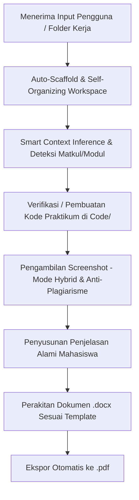

# NgeLaprak: Universal Laboratory Report Generator Skill

Skill ini memandu AI Agent dalam menyusun **Laporan Praktikum (Laprak)** yang rapi, profesional, dan otentik untuk berbagai mata kuliah teknik/informatika (seperti Struktur Data, ADPL, PBO, Basis Data, Pemrograman Web, Sistem Operasi, Jaringan Komputer, dll.).

Skill ini dilengkapi dengan kemampuan **Auto-Scaffold & Self-Organizing Workspace** serta **Smart Context Auto-Detection**, sehingga mahasiswa cukup menaruh berkas modul/template di folder mana pun tanpa repot menyusun folder manual.

Output yang dihasilkan adalah berkas **Microsoft Word (`.docx`)** dan **PDF (`.pdf`)** yang siap dikumpulkan.

---

## 1. Alur Kerja Utama (Workflow)



### Langkah 0: Smart Auto-Scaffold & Self-Organizing Workspace (Zero-Setup)
Banyak mahasiswa men-download file modul, template, dan TP lalu menaruh semuanya sekaligus di satu folder tanpa membuat subfolder (misal: di folder hanya ada `Modul 3.pdf`, `TP MODUL 3 STD.pdf`, dan `STRUKTUR-DATA_MOD-2_...pdf`).

Ketika dipanggil, AI Agent harus **segera merapikan direktori kerja secara mandiri**:
1. **Deteksi Berkas Tercecer (Loose Files)**:
   Periksa root direktori kerja. Jika berkas tercecer tanpa subfolder standar:
2. **Otomatis Buat Struktur Folder & Pindahkan Berkas**:
   - `Modul/` -> Berkas modul praktikum (`Modul*.pdf`, panduan, jobsheet) dan Tugas Pendahuluan (`TP*.pdf`, `Tugas Pendahuluan*`).
   - `Laprak/` -> Berkas laporan praktikum terdahulu / contoh template (`*_MOD-*`, `laprak*`, `template*`).
   - `Laprak/screenshots/` -> Tempat tangkapan layar manual jika ada.
   - `Code/` -> Folder projek / kodingan praktikum (`*.cpp`, `*.java`, `*.py`, `*.sql`, dll.).
   *(AI Agent dapat langsung menjalankan `python -m ngelaprak organize --path .` atau memindahkan berkas secara aman).*

---

### Langkah 0.5: Smart Context Auto-Detection (Deteksi Mandiri Tanpa Banyak Tanya)
AI Agent menganalisis berkas-berkas yang ada secara mandiri tanpa merepotkan pengguna dengan pertanyaan redundan:
1. **Deteksi Mata Kuliah**:
   - Ditelusuri dari nama berkas (misal `STRUKTUR-DATA_...` -> Struktur Data, `ADPL...` -> ADPL, `BASIS-DATA...` -> Basis Data).
   - Ditelusuri dari isi dokumen (header modul, judul matkul).
2. **Deteksi Modul Target**:
   - Ditelusuri dari nama berkas modul/TP (misal: ada `Modul 3.pdf` dan `TP MODUL 3 STD.pdf`, maka target yang dikerjakan adalah **Modul 3**).
   - Jika terdapat berkas `...MOD-2...`, sistem secara cerdas memahami bahwa Modul 2 adalah berkas referensi/template terdahulu!
3. **Deteksi Identitas Mahasiswa**:
   - NIM diekstrak dari penamaan berkas laprak lama (misal `109092500017`) atau teks cover.
   - Nama mahasiswa diekstrak dari penamaan berkas atau teks cover laprak lama (misal `Satria Bakti Wijaya`).
   - Asisten Praktikum diekstrak dari cover dokumen referensi.
4. **Deteksi Bahasa Pemrograman & Pilihan IDE**:
   - Jika ada kodingan di `Code/`, periksa ekstensi file (`.cpp` -> C++/Code::Blocks, `.java` -> Java/NetBeans, `.sql` -> SQL/DBeaver, `.py` -> Python/VS Code).
   - Jika folder `Code/` masih kosong, periksa kata kunci di modul materi (misal: `#include <iostream>`, `struct`, `cin` -> C++/Code::Blocks).
5. **Deteksi Institusi, Kampus & Identitas (Agnostik Multi-Kampus)**:
   - **Institusi**: Mendeteksi nama universitas, institut, politeknik, sekolah tinggi, atau akademi mana pun (Telkom, UI, ITB, UGM, ITS, Undip, Brawijaya, Polban, PENS, dll.).
   - **Identitas**: Fleksibel mendeteksi format nomor induk mahasiswa (`NIM`, `NPM`, `NRP`, `NISN`) baik dalam paragraf bertab maupun di dalam tabel identitas cover.
   - **Fakultas & Prodi**: Mengekstrak nama fakultas/sekolah dan program studi/jurusan/departemen langsung dari dokumen referensi tanpa memaksakan nilai default.
   - **Preservasi & Ekstraksi Logo**:
     - Jika template berformat `.docx`: Seluruh logo dan gambar cover otomatis dipertahankan pada posisi aslinya.
     - Jika template berformat `.pdf`: Gambar/logo cover diekstrak otomatis via `extract_cover_images_from_pdf` dan disematkan kembali ke cover baru.
6. **Deteksi Ketersediaan Kode**:
   - Jika kodingan belum tersedia di `Code/`, Agent secara mandiri memahami bahwa kodingan perlu dibuatkan di folder `Code/`, diuji coba jalannya, lalu diambil tangkapan layar outputnya.
7. **Saran Nama File Output Otomatis**:
   - Menyesuaikan format kampus dari template lama, misal `STRUKTUR-DATA_MOD-2_...` diubah otomatis menjadi `STRUKTUR-DATA_MOD-3_109092500017_SatriaBaktiWijaya.docx` (dan `.pdf`).

**Komunikasi Proaktif & Ringkas kepada Pengguna:**
Sampaikan temuan dalam 1–2 kalimat santai:
> *"Folder kerja sudah kurapikan ke `Modul/`, `Laprak/`, dan `Code/`. Aku mendeteksi tugas **Struktur Data - Modul 3 (ADT)** atas nama **Satria Bakti Wijaya (109092500017)** dengan **C++/Code::Blocks**. Karena kodingan praktikum belum ada, aku akan buatkan kodingannya di `Code/`, uji kompilasi & run, ambil screenshot, lalu rangkai laporannya. Boleh langsung kulanjutkan?"*

---

### Langkah 1: Ekstraksi Masukan & Anti-Plagiarisme
1. **Modul Praktikum (`Modul/Modul*.pdf`)**:
   - Ekstrak: Judul Pertemuan/Modul, Tujuan Praktikum, Tool yang digunakan, Dasar Teori, dan daftar tugas (Guided, Unguided, Latihan, Tugas Praktikum).
2. **Template Laprak Lama (`Laprak/*.docx` / `*.pdf`)**:
   - Ekstrak "DNA" laporan:
     - **Cover**: Format judul, logo kampus (posisi tengah/kiri, 1 atau 2 logo), format nama mahasiswa, NIM/NPM/NRP, asisten praktikum, prodi/jurusan, fakultas, institusi, dan tahun.
     - **Tipografi & Spasi**: Font (Times New Roman / Arial / Calibri), margin (4-4-3-3 atau 1 inci), spasi 1.15.
     - **Sistem Penomoran**: Romawi (I. TUJUAN, II. TOOL, III. DASAR TEORI, IV. GUIDED) atau huruf/angka.
3. **Kode Program (`Code/`)**:
   - Sisipkan identitas mahasiswa (Nama/NIM) di komentar `@author` kodingan atau title bar window untuk mencegah plagiarisme.
4. **Tugas Pendahuluan (TP) (Jika Ada)**:
   - Jawab pertanyaan TP secara singkat, padat, dan akurat dengan variasi kalimat natural mahasiswa.

---

### Langkah 2: Standarisasi Struktur Proyek IDE & Eksekusi Kode
Ketika mengimplementasikan atau menata kode praktikum mahasiswa di folder `Code/`, AI Agent **WAJIB** menerapkan struktur proyek resmi sesuai IDE target agar mahasiswa dapat langsung membukanya di Apache NetBeans atau Code::Blocks tanpa error:

1. **Untuk Java (Target IDE: Apache NetBeans)**:
   - **WAJIB** menggunakan struktur standar **Maven Project**:
     ```
     Code/
     ├── pom.xml                                  <- Konfigurasi Maven (Release 21/25 + dependencies)
     ├── nbactions.xml                            <- Pemetaan shortcut Run F6 NetBeans ke Main class
     └── src/
         └── main/
             └── java/
                 └── {packageName}/               <- Package sesuai deklarasi 'package ...;'
                     ├── *.java
     ```
   - **Auto-Dependency**: Jika kode menggunakan database (JDBC, MySQL, DriverManager, ResultSet), **WAJIB** sertakan dependensi `mysql-connector-j:8.3.0` di `pom.xml`.
   - **Main Class**: Pastikan `<exec.mainClass>` di `pom.xml` dan `nbactions.xml` menunjuk tepat ke kelas utama (misal `modul4.Main`).
   - *Dengan struktur ini, saat mahasiswa membuka NetBeans via `File -> Open Project` ke folder `Code`, NetBeans langsung memunculkan ikon cangkir kopi proyek resmi, tidak ada peringatan "Incorrect Package", dan tombol Run (F6) langsung berjalan lancar.*

2. **Untuk C / C++ (Target IDE: Code::Blocks)**:
   - **WAJIB** menyertakan berkas proyek Code::Blocks (`.cbp`):
     ```
     Code/
     ├── {ProjectName}.cbp                        <- File project Code::Blocks
     ├── main.cpp
     ├── {header}.h
     └── {source}.cpp
     ```
   - **Penanganan Multi-Task (Banyak Fungsi `main()`)**:
     - Jika modul praktikum memiliki beberapa soal terpisah yang masing-masing memiliki fungsi `main()` (misal `soal1.cpp`, `soal2.cpp`, `soal3.cpp`), **JANGAN** satukan dalam 1 file `.cbp` root (karena GCC akan memicu linker error `multiple definition of 'main'`).
     - **Pisahkan ke subfolder per tugas** (misal `Code/soal1/soal1.cbp`, `Code/soal2/soal2.cbp`) sehingga setiap project `.cbp` memiliki tepat 1 fungsi `main()`.
   - *Dengan struktur ini, mahasiswa cukup mendua-klik file `.cbp` untuk membuka project tree (Sources & Headers) di Code::Blocks dan langsung mengompilasi/menjalankan via shortcut F9.*

3. **Kompilasi & Validasi Kode**:
   - Kompilasi dan jalankan kode menggunakan tool yang sesuai (`mvn compile`, `g++`, `python`, `node`, dll.).
   - Pastikan tidak ada compile error.
   - Tangkap output program (console stdout, GUI window, database grid).

---

### Langkah 3: Screenshot Kode & Output (Mode Hybrid & Anti-Plagiarisme)

Gunakan **Mode Hybrid** untuk mendapatkan tangkapan layar yang paling otentik:

1. **Prioritas 1 - Screenshot Manual Mahasiswa**:
   - Periksa apakah mahasiswa telah menaruh screenshot asli di `Laprak/screenshots/`. Jika ada, gunakan file tersebut.

2. **Prioritas 2 - Generator Otomatis IDE Otentik (`ngelaprak.renderers`)**:
   - Jika screenshot manual tidak tersedia, gunakan generator bawaan `ngelaprak` yang menghasilkan tampilan **100% menyerupai editor asli**:
     - **Java / NetBeans (`netbeans_renderer.py`)**:
       - String literal berwarna hijau (`#008000`), static/field ungu miring (`#990066`), baris aktif pastel (`#fff9e6`), gutter nomor baris dengan hint bulb.
     - **C / C++ / Code::Blocks (`codeblocks_renderer.py`)**:
       - Font Consolas monospace khas Code::Blocks, gutter nomor baris abu-abu, keywords biru tua, include hijau, strings merah.
     - **Python / Web / VS Code (`vscode_renderer.py`)**:
       - Tema clean VS Code Dark+ atau Light+.
     - **Basis Data / SQL (`database_renderer.py`)**:
       - Tampilan editor query DBeaver / Navicat lengkap dengan syntax highlight dan tabel data grid baris & kolom hasil eksekusi.
     - **Terminal / Console & Simulasi CLI Interaktif (`terminal_renderer.py` & `cli_simulator.py`)**:
       - Console Command Prompt Windows / PowerShell / Bash terminal otentik.
       - **Simulasi Input Interaktif Mahasiswa**: Menampilkan alur interaksi multi-step (misal operasi CRUD, Stack push/pop, Queue antrian, Traversal Tree, Sorting pass-by-pass) dengan penanda visual input keyboard mahasiswa (`[[INPUT]]`), judul menu (`[[HEADER]]`), dan hasil sukses (`[[SUCCESS]]`). Menghindarkan kesan program yang hanya di-run 1 detik tanpa interaksi.
     - **Ekstraksi Logo Cover PDF Otomatis (`extract_cover_logo_from_pdf`)**:
       - Jika pengguna hanya menyertakan berkas laporan lama atau panduan berformat `.pdf` tanpa file Word `.docx`, sistem secara mandiri mengekstrak logo cover resolusi terbaik dari halaman 1 PDF dan menyimpannya ke `Laprak/screenshots/cover_logo.png` untuk disematkan ke cover Word baru.
     - **Jendela Java Swing Native (`gui_framer.py`)**:
       - Frame Windows 11 native dengan ikon cangkir Java 3D dan tombol vector native (Minimize, Maximize, Close X).
     - **Anti-Plagiarisme Dimensi Gambar**:
       - Seluruh renderer otomatis menyisipkan jitter acak (~15–55 px) sehingga ukuran pixel gambar setiap mahasiswa unik dan berbeda.

---

### Langkah 4: Gaya Bahasa Penulisan (Human-Like & Anti-AI)

Tuliskan penjelasan kode dan dasar teori dengan aturan berikut:
- **Gaya Bahasa Mahasiswa Santai & Pragmatis**: Singkat, jelas, langsung ke fungsi kode (*to the point*).
- **Hindari Ciri Bahasa AI**:
  - JANGAN gunakan kata-kata klise robotik: *"Kode ini mendemonstrasikan implementasi komprehensif...", "Melalui arsitektur ini, integritas data terjamin..."*.
  - GUNAKAN gaya natural mahasiswa: *"Fungsi ini dipake buat...", "Di sini kita inisialisasi struct kendaraan...", "Bagian ini buat nampilin data yang udah diinput..."*.

---

### Langkah 5: Standarisasi Tipografi Dokumen Sesuai Template (Anti-Bold Liar)

Untuk memastikan dokumen Word & PDF **100% identik dengan format acuan kampus/asisten** dan tidak terjadi kesalahan teks tebal (*bold*) yang berlebihan:

#### 1. Tabel Standarisasi Elemen & Font Dokumen:

| Bagian Dokumen | Elemen Teks | Jenis Font | Ukuran Font | Status Bold | Alignment | Indentasi / Catatan |
|---|---|---|---|---|---|---|
| **Cover** | Judul Modul & Pertemuan | Times New Roman | 14 pt | **Bold (`True`)** | Center | Line spacing 1.15 |
| **Cover** | Nama Mahasiswa | Times New Roman | 12 pt | **Bold (`True`)** | Left / Tab | Label & Nama Mahasiswa |
| **Cover** | Nama (NIM) | Times New Roman | 12 pt | **Non-Bold (`False`)** | Left / Tab | Angka NIM tidak di-bold |
| **Cover** | Asisten Praktikum | Times New Roman | 12 pt | **Non-Bold (`False`)** | Left / Tab | Nama & NIM asisten tidak bold |
| **Bab Utama** | `I. TUJUAN`, `II. TOOL`, `III. DASAR TEORI`, `IV. GUIDED` | Times New Roman | 14 pt | **Bold (`True`)** | Justify | Spasi Before 10pt, After 4pt |
| **I. TUJUAN** | Butir Poin (`1. ...`, `2. ...`) | Times New Roman | 12 pt | **Non-Bold (`False`)** | Justify | Spasi After 2pt |
| **II. TOOL** | Deskripsi Tool (`NetBeans, JDK 25...`) | Times New Roman | 11 pt | **Non-Bold (`False`)** | Left | Left Indent 0.4 inci |
| **III. DASAR TEORI**| Paragraf Penjelasan Teori | Times New Roman | 12 pt | **Non-Bold (`False`)** | **Justify** | **First-line indent ~0.35–0.4 in (~0.8 cm)**, spasi 1.15 |
| **IV. GUIDED** | Sub-item Kode (`1.) TestJDBC.java`) | Times New Roman | 11 pt | **Non-Bold (`False`)** | Justify | Spasi Before 8pt, After 2pt |
| **IV. GUIDED** | Label `Kode` | Times New Roman | 11 pt | **Non-Bold (`False`)** | Justify | Spasi Before 4pt, After 2pt |
| **IV. GUIDED** | Gambar Screenshot Kode | - | - | - | Center | Lebar 5.2 inci, Spasi After 6pt |
| **IV. GUIDED** | Label `Penjelasan` | Times New Roman | 11 pt | **Non-Bold (`False`)** | Justify | Spasi Before 4pt, After 2pt |
| **IV. GUIDED** | Paragraf Penjelasan Kode | Times New Roman | 11 pt | **Non-Bold (`False`)** | **Justify** | **First-line indent ~0.4 in (~1 cm)**, spasi 1.15 |
| **Output** | Label `Output` | Times New Roman | 11 pt | **Non-Bold (`False`)** | Justify | Spasi Before 8pt, After 2pt |
| **Output** | Gambar Screenshot GUI / DB / CLI | - | - | - | Center | Lebar 4.8 inci, Spasi After 6pt |

#### 2. Aturan Larangan Teknis Agent (Critical Rule):
- **DILARANG KERAS** menggunakan `doc.paragraphs[x].text = "..."` secara mentah pada paragraf bawaan template!
  - *Penyebab*: Jika paragraf tersebut memiliki style Heading (misal `Heading 1`), python-docx akan menghapus run sebelumnya dan membuat run baru tanpa tag `<w:b w:val="0"/>`, sehingga teks mewarisi sifat bold dari Heading. Inilah yang menyebabkan Tujuan dan Dasar Teori menjadi **bold semua**.
- **WAJIB** gunakan metode terstruktur `LaprakDocxBuilder` yang telah terintegrasi dengan proteksi tipografi:
  ```python
  from ngelaprak.core import LaprakDocxBuilder, export_docx_to_pdf

  builder = LaprakDocxBuilder(template_path=TEMPLATE_PATH)

  # 1. Update Cover & Identitas
  builder.set_cover_title("PERTEMUAN 4", "MODUL 4: GUI Part 3 & JDBC")
  builder.set_student_info(nama="Khilma 'Ainunnajah", nim="109092530004")

  # 2. Update Tujuan (Otomatis Non-Bold, 12pt Times New Roman)
  builder.set_objectives([
      "1. Mengenal konsep JDBC dan cara menghubungkan Java dengan database.",
      "2. Menggunakan JDBC Driver dalam aplikasi Java.",
      "3. Mengimplementasikan operasi CRUD (Create, Read, Update, Delete) dalam aplikasi berbasis GUI."
  ])

  # 3. Update Tool (Otomatis Non-Bold, 11pt Times New Roman, Indent Kiri)
  builder.set_tools("NetBeans, JDK 25, MySQL / Laragon")

  # 4. Update Dasar Teori (Otomatis Non-Bold, 12pt Times New Roman, Justified, First-Line Indent)
  builder.set_dasar_teori(
      "Java Database Connectivity (JDBC) adalah spesifikasi API standar dari Java yang digunain..."
  )

  # 5. Rakit Guided Items (Otomatis Non-Bold untuk judul item, label Kode, dan label Penjelasan)
  builder.clear_guided_section(keep_until_p_index=35)
  builder.add_code_item("1.) TestJDBC.java", [shot_test], "Penjelasan kode non-bold...")

  # 6. Output Section (Otomatis Non-Bold untuk header Output)
  builder.add_output_section([shot_gui, shot_db])

  # 7. Simpan Dokumen (Otomatis menjalankan sanitize_document_typography())
  builder.save(docx_output)

  # 8. Ekspor PDF
  export_docx_to_pdf(docx_output, pdf_output)
  ```
- **Fitur Otomatis `sanitize_document_typography()`**:
  Fungsi ini berjalan otomatis saat `builder.save()` dipanggil. Seluruh paragraf tubuh dokumen akan dipindai; jika ada run yang secara tidak sengaja berstatus bold, sistem akan memaksanya menjadi `bold = False`. Hanya bab utama (`I. TUJUAN`, `II. TOOL`, `III. DASAR TEORI`, `IV. GUIDED`) yang diperbolehkan berstatus bold.

---

### Langkah 6: Perakitan Dokumen Word (`.docx`) & PDF (`.pdf`)

1. **Tata Letak & Spasi Halaman**:
   - Iris kode panjang menjadi ~20–25 baris per gambar agar tidak memicu pemotongan halaman janggal.
   - Skalakan lebar gambar proporsional (`width = Inches(5.2)` sampai `Inches(5.5)`).
   - Pastikan teks penjelasan berada tepat di bawah gambar kode terkait.
2. **Kompilasi Word (`.docx`)**:
   - Bangun file menggunakan `LaprakDocxBuilder` dengan menerapkan style, font, dan cover yang identik dengan template awal.
3. **Ekspor PDF Otomatis**:
   - Di Windows: Ekspor langsung melalui Microsoft Word COM Automation (`Word.Application`).
   - Di Linux / macOS: Gunakan LibreOffice headless (`soffice --headless --convert-to pdf`).

---

## 2. Struktur Direktori Standar

```
<Workspace Folder>/
├── Modul/               <- Berkas modul praktikum & TP dari dosen/asisten (PDF / Word)
├── Laprak/              <- Template contoh laprak lama & tempat hasil .docx / .pdf
│   └── screenshots/     <- Tempat screenshot manual mahasiswa / hasil render
└── Code/                <- Projek kodingan praktikum resmi IDE
    ├── (Untuk Java)     -> pom.xml, nbactions.xml, src/main/java/{pkg}/*.java
    └── (Untuk C++)      -> {Project}.cbp, main.cpp, *.h, *.cpp
```

---

## 3. Perintah CLI Pendukung

```bash
# Auto-scaffold dan rapikan file tercecer ke Modul/, Laprak/, dan Code/ (auto setup NetBeans / CodeBlocks)
python -m ngelaprak organize

# Deteksi otomatis konteks modul, mahasiswa, bahasa & IDE tanpa memindahkan file
python -m ngelaprak analyze

# Inisialisasi struktur folder laporan (bisa langsung spesifik IDE: --lang java / --lang cpp)
python -m ngelaprak init --lang java
python -m ngelaprak init --lang cpp

# Render screenshot IDE otentik
python -m ngelaprak render --ide netbeans --file Code/src/main/java/modul4/Main.java --out Laprak/screenshots/main.png
python -m ngelaprak render --ide codeblocks --file Code/main.cpp --out Laprak/screenshots/code1.png

# Simulasi & render output CLI interaktif mahasiswa (multi-step input)
python -m ngelaprak simulate-cli --type stack --out Laprak/screenshots/cli_interactive.png
python -m ngelaprak simulate-cli --type queue --out Laprak/screenshots/queue_interactive.png

# Ekspor berkas Word ke PDF
python -m ngelaprak export-pdf --docx Laprak/Laporan.docx
```
